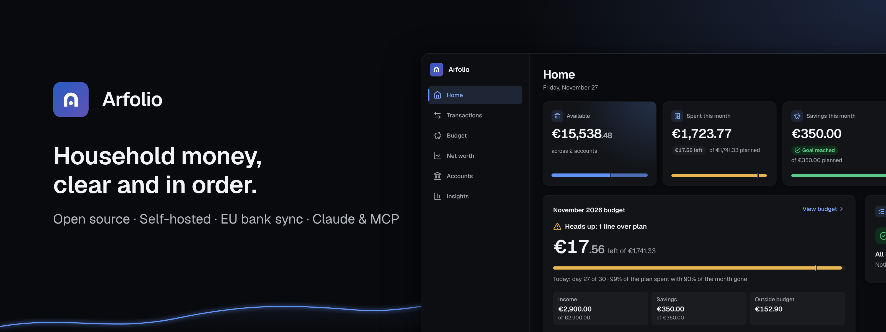
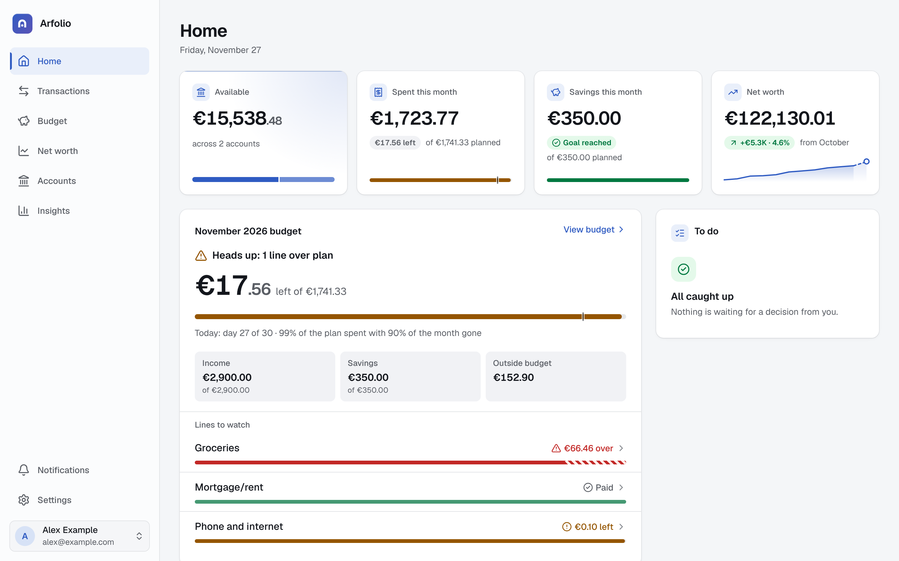
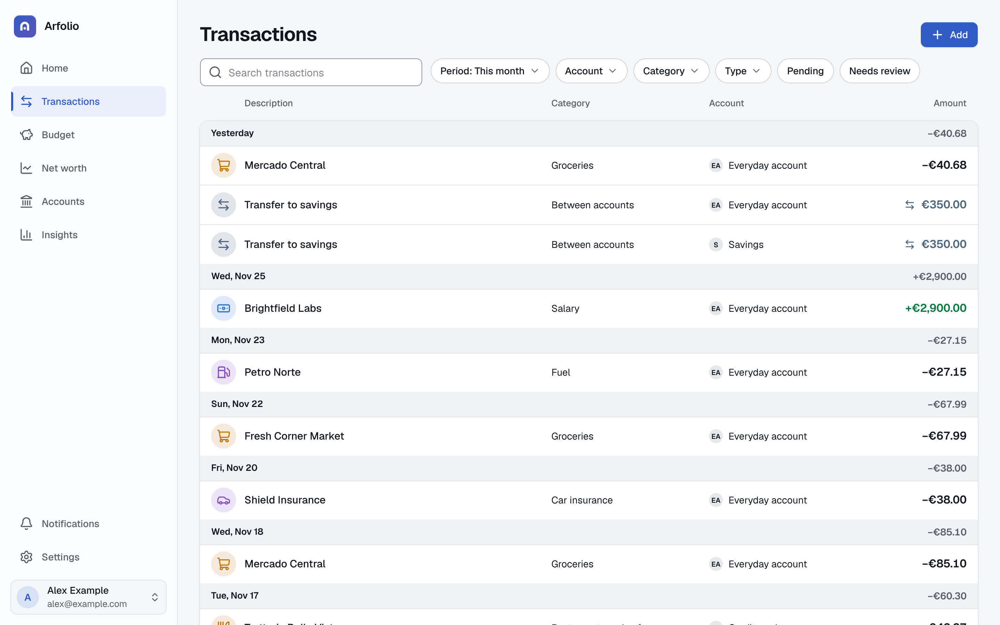
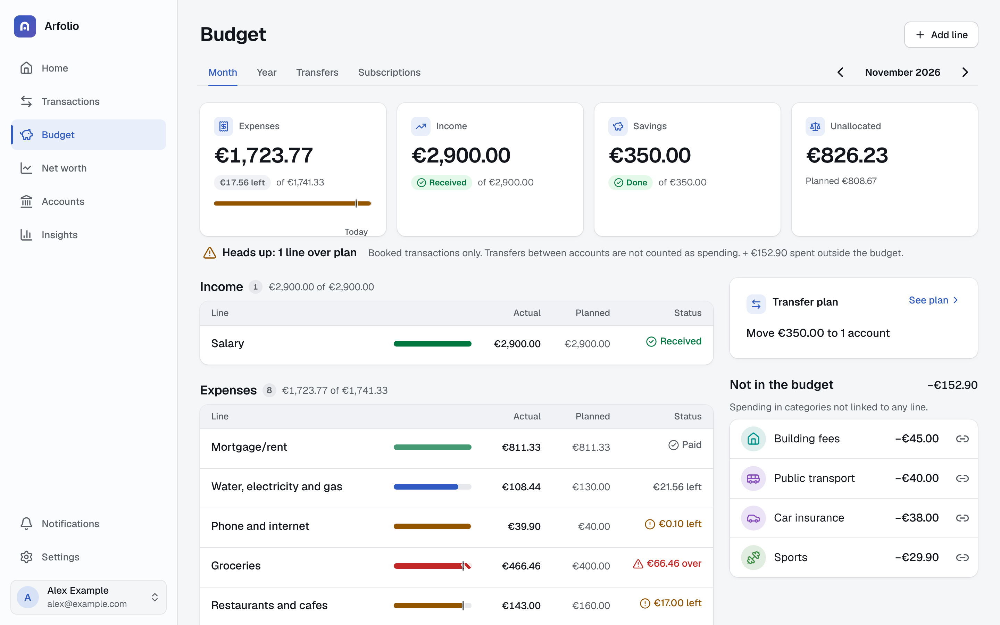
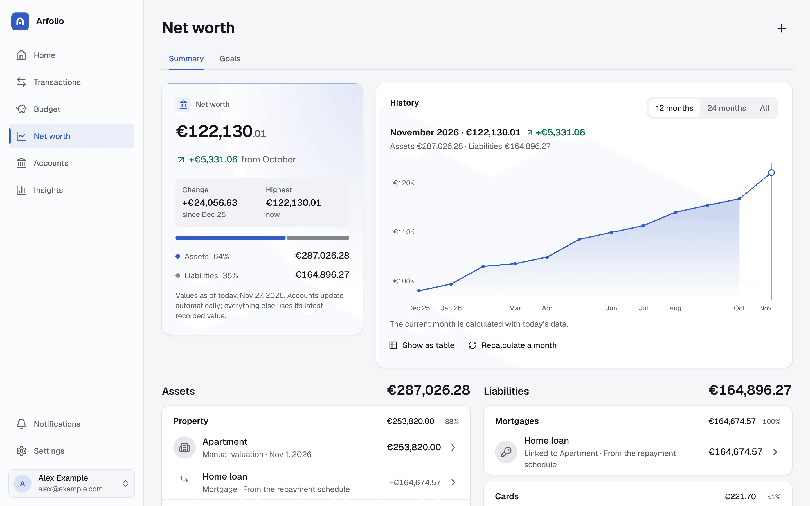
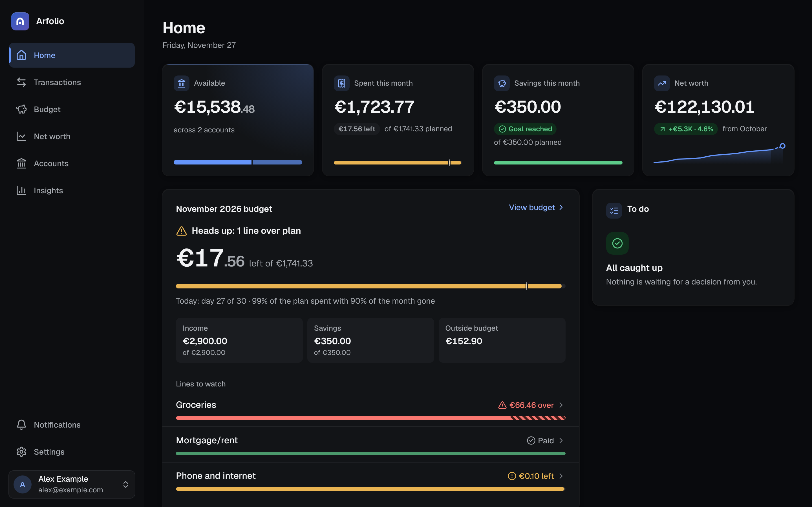
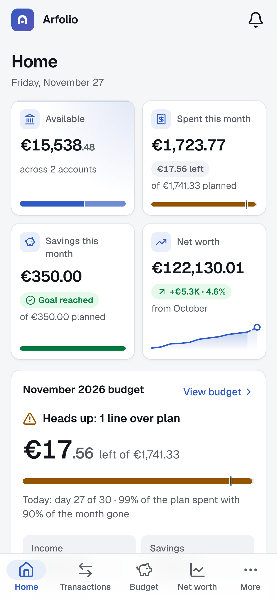

<p align="center">
  
</p>

# Arfolio

**Self-hosted household finance.** Arfolio pulls in your bank movements every day, categorises them, and shows whether this month is on plan and what your net worth is, without sending your data to anyone's cloud. You run it on your own VM or home server with one `docker compose up`.

## Why

A budget is only a plan until it is compared with what actually happened, and doing that by hand is too much work to keep up. Arfolio closes the loop automatically: it syncs accounts, recognises transfers between your own accounts so they never count as spending, learns your categories, and answers "are we on track?" in about ten seconds on your phone.

- **Yours.** Your data lives in your own PostgreSQL. No account with us, no telemetry, no hosted service.
- **Read-only.** Bank and broker connections can read balances and transactions. Arfolio can never move money.
- **For households.** Several people, each with their own sign-in and a role (owner, member or viewer), one shared set of books. Owners need two-step verification.
- **Honest about the cloud.** The few things that do leave your server are listed [below](#what-leaves-your-server).

## Features

- **Accounts and bank sync:** European banks through Enable Banking, Trading 212 for investments, statement import (CSV, XLSX, OFX) and manual accounts, including cards and loans.
- **Transactions:** search and filters, categories, rules, merchant memory, a review inbox for the movements the app was unsure about, automatic detection of transfers between your accounts, recurring payments.
- **AI categorisation (optional):** a model suggests categories for what your rules left over; you stay in control.
- **Budgets and saving lines:** an annual budget of income, expenses and savings, budget versus actual by line and group, and a transfer plan from your main account.
- **Goals:** savings goals with projections.
- **Net worth:** accounts, investments, property, vehicles and other assets, minus mortgages, loans and debts, with monthly history. Optional AI valuation of property, vehicles and valuables from comparable listings.
- **Insights:** charts, anomalies and an AI-written monthly report (optional).
- **Claude, via MCP:** connect claude.ai or Claude Code to ask about your money and, if you allow it, record things.
- **Phone-friendly:** installable PWA with push notifications and an offline read-only shell.
- **Households:** members, invitations, roles, two-step verification, audit log.
- **Five interface languages** (English, European Portuguese, Spanish, French and Italian), privacy mode that masks every amount on screen, and white-label branding (name, colour, logo) by environment variable.
- **Services page:** AI, bank connections and email are configured by the owner in **Settings > Services**, no file editing.

## Screenshots

|                                                           |                                                                                            |
| --------------------------------------------------------- | ------------------------------------------------------------------------------------------ |
|             |                              |
| **Home**: the ten-second answer                           | **Transactions**: categorised, searchable, with a review inbox                             |
|         |                                    |
| **Budget**: plan against actual                           | **Net worth**: assets, liabilities and history                                             |
|  |  |
| **Dark theme**                                            | **On a phone**                                                                             |

The screenshots show invented demo data.

## Quick start

You need a Linux machine with Docker and the Compose plugin.

```sh
git clone https://github.com/nunoarmada/arfolio.git
cd arfolio
./scripts/init-env.sh          # writes .env with fresh random secrets
docker compose up -d           # PostgreSQL, migrations, web, worker
grep '^SETUP_TOKEN=' .env      # the setup code you enter once
```

Then open <http://localhost:3000/setup>, enter the setup code and create your household and owner account. **Back up `ENCRYPTION_KEY` from `.env` with your database backups**: without it stored bank sessions and keys cannot be read.

The image `ghcr.io/nunoarmada/arfolio` is published with each release. Until the first release is out, build from source: uncomment `build: .` in `compose.yaml` and run `docker compose build` before `docker compose up -d`.

For remote access put a reverse proxy with HTTPS in front and set `APP_URL`; the [install guide](docs/install.md) has the details, a Caddy example and troubleshooting. On Kubernetes use the [Helm chart](docs/kubernetes.md).

## Configuration

Server basics (database, secrets, public URL) are environment variables in `.env`. Everything else (AI, bank connections, email) the owner sets in **Settings > Services**; an environment variable, if set, wins over the page. All of it is in [docs/configuration.md](docs/configuration.md).

## What leaves your server

Your data stays in your database. Arfolio talks to these outside services only when you set them up:

- **Enable Banking**, to connect European banks. Their restricted production mode is meant for linking your own accounts; see [enablebanking.com](https://enablebanking.com) for their current terms. The [bank sync guide](docs/bank-sync.md) walks through it.
- **Anthropic**, if you add your own API key and a household switches AI on. Descriptions are redacted (IBANs, card numbers, emails, phone numbers and long digit runs removed) and reports use aggregates only. [AI features](docs/ai.md) lists exactly what is sent.
- **Google's favicon service**, to show merchant logos. It learns the merchant's website, never your transactions. Turn it off with `MERCHANT_LOGOS=off`.

Without an Enable Banking application and an Anthropic key Arfolio still works: add accounts by hand or import statements.

## Documentation

| Guide                                            | What is in it                                                                     |
| ------------------------------------------------ | --------------------------------------------------------------------------------- |
| [Install with Docker Compose](docs/install.md)   | Step by step install, HTTPS, first run                                            |
| [Install on Kubernetes](docs/kubernetes.md)      | The Helm chart (full values in the [chart README](deploy/helm/arfolio/README.md)) |
| [Configuration](docs/configuration.md)           | Every environment variable and the Services page, with precedence                 |
| [Bank sync](docs/bank-sync.md)                   | Enable Banking and Trading 212 step by step                                       |
| [AI features](docs/ai.md)                        | What is sent to Anthropic, redaction, models, costs, valuation portals            |
| [Connect Claude (MCP)](docs/mcp.md)              | claude.ai, Claude Code, tokens, revoking access                                   |
| [Backup and upgrade](docs/backup-and-upgrade.md) | `ENCRYPTION_KEY`, backup, restore, upgrades, pre-release installs                 |
| [Architecture](docs/architecture.md)             | Stack, tenancy, security model, jobs                                              |
| [Changelog](CHANGELOG.md)                        | What changed in each release                                                      |

Contributing: [CONTRIBUTING.md](CONTRIBUTING.md) (including the demo data seed) and the [Code of Conduct](CODE_OF_CONDUCT.md). Security reports: [SECURITY.md](SECURITY.md). Brand assets: [docs/brand](docs/brand/README.md).

## Licence

The code is licensed under the [GNU AGPL v3](LICENSE) (`AGPL-3.0-only`). The documentation and the prose of this README are licensed under [CC BY 4.0](LICENSE-docs.md). The "Arfolio" name and logo are not licensed for forks or modified versions: see [TRADEMARK.md](TRADEMARK.md); rebranding is built in.

## Credits

Built by Nuno Armada. Arfolio stands on [Next.js](https://nextjs.org), [React](https://react.dev), [Better Auth](https://www.better-auth.com), [Drizzle ORM](https://orm.drizzle.team), [pg-boss](https://github.com/timgit/pg-boss), [PostgreSQL](https://www.postgresql.org), [Tailwind CSS](https://tailwindcss.com), [next-intl](https://next-intl.dev), [Serwist](https://serwist.pages.dev), the [Model Context Protocol](https://modelcontextprotocol.io) SDK and the [Geist](https://vercel.com/font) typeface, among many other open-source projects.
